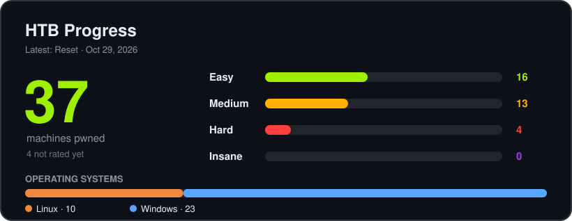

<div align="center">

# 🏴‍☠️ HTB WalkThroughs

**Hack The Box machine write-ups — from the first nmap scan to root.**
Each one explains the *why* behind every step, not just the commands.

<!-- BADGES:START -->
<p align="center">


<br>


</p>
<!-- BADGES:END -->

</div>

---

## 📊 At a glance

<!-- STATS:START -->
<p align="center"></p>

| Difficulty | Machines | Share |
|:--|:-:|:--|
| 🟢 **Easy** | 14 | `▰▰▰▰▰▰▰▰▰▱▱▱▱▱▱▱▱▱▱▱` 45% |
| 🟠 **Medium** | 11 | `▰▰▰▰▰▰▰▱▱▱▱▱▱▱▱▱▱▱▱▱` 35% |
| 🔴 **Hard** | 3 | `▰▰▱▱▱▱▱▱▱▱▱▱▱▱▱▱▱▱▱▱` 10% |
| 🟣 **Insane** | 0 | `▱▱▱▱▱▱▱▱▱▱▱▱▱▱▱▱▱▱▱▱` 0% |
| ⚪ Unrated | 3 | `▰▰▱▱▱▱▱▱▱▱▱▱▱▱▱▱▱▱▱▱` 10% |
| **Total** | **31** | |

**📅 Activity — last 6 months**

| Month | Solved | |
|:--|:-:|:--|
| May 2026 | 2 | `▰▰▱▱▱▱▱▱▱▱▱▱▱▱▱▱` |
| Jun 2026 | 7 | `▰▰▰▰▰▰▰▰▰▱▱▱▱▱▱▱` |
| Jul 2026 | 2 | `▰▰▱▱▱▱▱▱▱▱▱▱▱▱▱▱` |
| Aug 2026 | 0 | `▱▱▱▱▱▱▱▱▱▱▱▱▱▱▱▱` |
| Sep 2026 | 0 | `▱▱▱▱▱▱▱▱▱▱▱▱▱▱▱▱` |
| Oct 2026 | 13 | `▰▰▰▰▰▰▰▰▰▰▰▰▰▰▰▰` |
<!-- STATS:END -->

## 🆕 Recently solved

<!-- RECENT:START -->
| Machine | Difficulty | OS | Solved |
|:--|:-:|:-:|:-:|
| **[Devvortex](Devvortex/README.md)** | 🟢 Easy | 🐧 Linux | Oct 24, 2026 |
| **[Voleur](Voleur/README.md)** | 🟠 Medium | 🪟 Windows | Oct 24, 2026 |
| **[GoodGames](GoodGames/README.md)** | 🟢 Easy | 🐧 Linux | Oct 23, 2026 |
| **[Logging](Logging/README.md)** | 🟠 Medium | 🪟 Windows | Oct 23, 2026 |
| **[Overwatch](Overwatch/README.md)** | 🟠 Medium | 🪟 Windows | Oct 21, 2026 |
<!-- RECENT:END -->

## 🗂️ All write-ups

> Click a difficulty to expand it. Newest first.

<!-- MACHINES:START -->
<details>
<summary><b>🟢 Easy</b> — 14 machines</summary>

| Machine | OS | Solved |
|:--|:-:|:-:|
| [Devvortex](Devvortex/README.md) | 🐧 Linux | Oct 24, 2026 |
| [GoodGames](GoodGames/README.md) | 🐧 Linux | Oct 23, 2026 |
| [Devel](Devel/README.md) | 🪟 Windows | Oct 20, 2026 |
| [Driver](Driver/README.md) | 🪟 Windows | Oct 19, 2026 |
| [Sau](Sau/README.md) | 🐧 Linux | Oct 19, 2026 |
| [Support](Support/README.md) | 🪟 Windows | Oct 5, 2026 |
| [Touch](Touch/README.md) | 🪟 Windows | Oct 5, 2026 |
| [Fluffy](Fluffy/README.md) | 🪟 Windows | Jun 28, 2026 |
| [Sauna](Sauna/README.md) | 🪟 Windows | Jun 19, 2026 |
| [Bounty](Bounty/bounty.md) | 🪟 Windows | May 3, 2026 |
| [Active](Active/active.md) | 🪟 Windows | Apr 30, 2026 |
| [Baby](Baby/baby.md) | 🪟 Windows | Apr 30, 2026 |
| [Forest](Forest/forest.md) | 🪟 Windows | Apr 30, 2026 |
| [Traverxec](Traverxec/traverxec.md) | 🐧 Linux | Apr 30, 2026 |

</details>

<details>
<summary><b>🟠 Medium</b> — 11 machines</summary>

| Machine | OS | Solved |
|:--|:-:|:-:|
| [Voleur](Voleur/README.md) | 🪟 Windows | Oct 24, 2026 |
| [Logging](Logging/README.md) | 🪟 Windows | Oct 23, 2026 |
| [Overwatch](Overwatch/README.md) | 🪟 Windows | Oct 21, 2026 |
| [Administrator](Administrator/README.md) | 🪟 Windows | Oct 20, 2026 |
| [Layover](Layover/README.md) | 🐧 Linux | Oct 7, 2026 |
| [Jeeves](Jeeves/README.md) | 🪟 Windows | Jul 5, 2026 |
| [Escape](Escape/README.md) | 🪟 Windows | Jun 25, 2026 |
| [Certified](Certified/README.md) | 🪟 Windows | Jun 8, 2026 |
| [DevHub](DevHub/README.md) | 🐧 Linux | Jun 1, 2026 |
| [Cicada](Cicada/cicada.md) | 🪟 Windows | May 24, 2026 |
| [Cronos](Cronos/cronos.md) | 🐧 Linux | Apr 30, 2026 |

</details>

<details>
<summary><b>🔴 Hard</b> — 3 machines</summary>

| Machine | OS | Solved |
|:--|:-:|:-:|
| [TombWatcher](TombWatcher/README.md) | 🪟 Windows | Jul 6, 2026 |
| [Garfield](Garfield/README.md) | 🪟 Windows | Jun 28, 2026 |
| [Blackfield](Blackfield/README.md) | 🪟 Windows | Jun 19, 2026 |

</details>

<details>
<summary><b>⚪ Unrated</b> — 3 machines</summary>

| Machine | OS | Solved |
|:--|:-:|:-:|
| [Stream](Stream/README.md) | — | Oct 15, 2026 |
| [Kobold](Kobold/kobold.md) | — | Apr 30, 2026 |
| [WingData](WingData/wingdata.md) | — | Apr 30, 2026 |

</details>
<!-- MACHINES:END -->

## 🧭 How every write-up is structured

| | Phase | What you'll find |
|:-:|:--|:--|
| 1️⃣ | **Recon** | Port scans, service and web enumeration |
| 2️⃣ | **Foothold** | The vulnerability, the exploit, the first shell |
| 3️⃣ | **Privilege escalation** | Local enumeration → root / SYSTEM / Domain Admin |
| 4️⃣ | **Takeaways** | What I learned, plus detection and mitigation ideas |


```markdown
# HTB Write-Up: MachineName

| Field      | Details                                                           |
|------------|-------------------------------------------------------------------|
| Platform   | [Hack The Box](https://app.hackthebox.com/machines/MachineName)   |
| Difficulty | Easy / Medium / Hard / Insane                                     |
| OS         | Linux / Windows                                                   |
| Date       | Month DD, YYYY                                                    |
```

If `Difficulty`, `OS` or `Date` are missing, the generator falls back to `scripts/overrides.csv`, and for the date to the first git commit of that folder.

</details>

---
