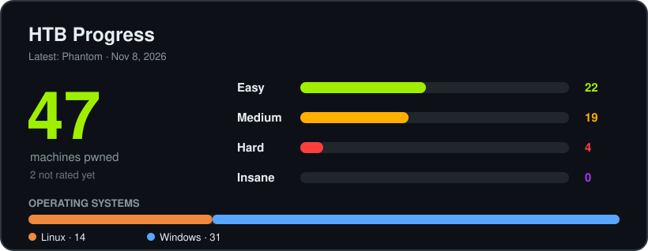

# 🏴‍☠️ HTB WalkThroughs

**Hack The Box machine write-ups — from the first nmap scan to root.**
Each one explains the *why* behind every step, not just the commands.

<!-- BADGES:START -->

 

<!-- BADGES:END -->

---

## 📊 At a glance

<!-- STATS:START -->

| Difficulty | Machines | Share |
|:--|:-:|:--|
| 🟢 **Easy** | 22 | `▰▰▰▰▰▰▰▰▰▱▱▱▱▱▱▱▱▱▱▱` 45% |
| 🟠 **Medium** | 23 | `▰▰▰▰▰▰▰▰▰▱▱▱▱▱▱▱▱▱▱▱` 47% |
| 🔴 **Hard** | 4 | `▰▰▱▱▱▱▱▱▱▱▱▱▱▱▱▱▱▱▱▱` 8% |
| 🟣 **Insane** | 0 | `▱▱▱▱▱▱▱▱▱▱▱▱▱▱▱▱▱▱▱▱` 0% |
| **Total** | **49** | |
<!-- STATS:END -->

## 🆕 Recently solved

<!-- RECENT:START -->
| Machine | Difficulty | OS | Solved |
|:--|:-:|:-:|:-:|
| **[Intelligence](Intelligence/README.md)** | 🟠 Medium | 🪟 Windows | Nov 14, 2026 |
| **[Breach](Breach/README.md)** | 🟠 Medium | 🪟 Windows | Nov 10, 2026 |
| **[Phantom](Phantom/README.md)** | 🟠 Medium | 🪟 Windows | Nov 8, 2026 |
| **[Sendai](Sendai/README.md)** | 🟠 Medium | 🪟 Windows | Nov 8, 2026 |
| **[Precious](Precious/README.md)** | 🟢 Easy | 🐧 Linux | Nov 7, 2026 |
<!-- RECENT:END -->

## 🗂️ All write-ups

> Click a difficulty to expand it. Newest first.

<!-- MACHINES:START -->

<b>🟢 Easy</b> — 22 machines

| Machine | OS | Solved |
|:--|:-:|:-:|
| [Precious](Precious/README.md) | 🐧 Linux | Nov 7, 2026 |
| [EscapeTwo](EscapeTwo/README.md) | 🪟 Windows | Nov 3, 2026 |
| [Titanic](Titanic/README.md) | 🐧 Linux | Nov 2, 2026 |
| [Timelapse](Timelapse/README.md) | 🪟 Windows | Oct 31, 2026 |
| [Reset](Reset/README.md) | 🐧 Linux | Oct 29, 2026 |
| [CodePartTwo](CodePartTwo/README.md) | 🐧 Linux | Oct 28, 2026 |
| [Devvortex](Devvortex/README.md) | 🐧 Linux | Oct 24, 2026 |
| [GoodGames](GoodGames/README.md) | 🐧 Linux | Oct 23, 2026 |
| [Devel](Devel/README.md) | 🪟 Windows | Oct 20, 2026 |
| [Driver](Driver/README.md) | 🪟 Windows | Oct 19, 2026 |
| [Sau](Sau/README.md) | 🐧 Linux | Oct 19, 2026 |
| [Support](Support/README.md) | 🪟 Windows | Oct 5, 2026 |
| [Touch](Touch/README.md) | 🪟 Windows | Oct 5, 2026 |
| [Fluffy](Fluffy/README.md) | 🪟 Windows | Jun 28, 2026 |
| [Sauna](Sauna/README.md) | 🪟 Windows | Jun 19, 2026 |
| [Bounty](Bounty/bounty.md) | 🪟 Windows | May 3, 2026 |
| [Active](Active/active.md) | 🪟 Windows | Apr 30, 2026 |
| [Baby](Baby/baby.md) | 🪟 Windows | Apr 30, 2026 |
| [Forest](Forest/forest.md) | 🪟 Windows | Apr 30, 2026 |
| [Kobold](Kobold/kobold.md) | 🐧 Linux | Apr 30, 2026 |
| [Traverxec](Traverxec/traverxec.md) | 🐧 Linux | Apr 30, 2026 |
| [WingData](WingData/wingdata.md) | 🐧 Linux | Apr 30, 2026 |

<b>🟠 Medium</b> — 23 machines

| Machine | OS | Solved |
|:--|:-:|:-:|
| [Intelligence](Intelligence/README.md) | 🪟 Windows | Nov 14, 2026 |
| [Breach](Breach/README.md) | 🪟 Windows | Nov 10, 2026 |
| [Phantom](Phantom/README.md) | 🪟 Windows | Nov 8, 2026 |
| [Sendai](Sendai/README.md) | 🪟 Windows | Nov 8, 2026 |
| [VulnCicada](VulnCicada/README.md) | 🪟 Windows | Nov 7, 2026 |
| [Job](Job/README.md) | 🪟 Windows | Nov 6, 2026 |
| [Puppy](Puppy/README.md) | 🪟 Windows | Nov 1, 2026 |
| [Media](Media/README.md) | 🪟 Windows | Oct 30, 2026 |
| [DutyBound](DutyBound/README.md) | 🐧 Linux | Oct 27, 2026 |
| [Delegate](Delegate/README.md) | 🪟 Windows | Oct 26, 2026 |
| [Expressway](Expressway/README.md) | 🐧 Linux | Oct 26, 2026 |
| [Voleur](Voleur/README.md) | 🪟 Windows | Oct 24, 2026 |
| [Logging](Logging/README.md) | 🪟 Windows | Oct 23, 2026 |
| [Overwatch](Overwatch/README.md) | 🪟 Windows | Oct 21, 2026 |
| [Administrator](Administrator/README.md) | 🪟 Windows | Oct 20, 2026 |
| [Stream](Stream/README.md) | 🐧 Linux | Oct 15, 2026 |
| [Layover](Layover/README.md) | 🐧 Linux | Oct 7, 2026 |
| [Jeeves](Jeeves/README.md) | 🪟 Windows | Jul 5, 2026 |
| [Escape](Escape/README.md) | 🪟 Windows | Jun 25, 2026 |
| [Certified](Certified/README.md) | 🪟 Windows | Jun 8, 2026 |
| [DevHub](DevHub/README.md) | 🐧 Linux | Jun 1, 2026 |
| [Cicada](Cicada/cicada.md) | 🪟 Windows | May 24, 2026 |
| [Cronos](Cronos/cronos.md) | 🐧 Linux | Apr 30, 2026 |

<b>🔴 Hard</b> — 4 machines

| Machine | OS | Solved |
|:--|:-:|:-:|
| [DarkZero](DarkZero/README.md) | 🪟 Windows | Oct 25, 2026 |
| [TombWatcher](TombWatcher/README.md) | 🪟 Windows | Jul 6, 2026 |
| [Garfield](Garfield/README.md) | 🪟 Windows | Jun 28, 2026 |
| [Blackfield](Blackfield/README.md) | 🪟 Windows | Jun 19, 2026 |

<!-- MACHINES:END -->

## 🧭 How every write-up is structured

| | Phase | What you'll find |
|:-:|:--|:--|
| 1️⃣ | **Recon** | Port scans, service and web enumeration |
| 2️⃣ | **Foothold** | The vulnerability, the exploit, the first shell |
| 3️⃣ | **Privilege escalation** | Local enumeration → root / SYSTEM / Domain Admin |
| 4️⃣ | **Takeaways** | What I learned, plus detection and mitigation ideas |

